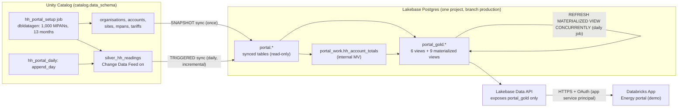

# HH portal on Lakebase (demo)

**Status:** Demo, ready to deploy into your own workspace
**Data:** SYNTHETIC only (fabricated organisations, meters and readings)

An end-to-end example of serving a half-hourly (HH) energy consumption portal from Databricks Lakebase:

synthetic data -> Unity Catalog silver (Change Data Feed) -> Lakebase synced tables (refreshed daily, TRIGGERED)
-> gold views and materialized views built **inside** Lakebase -> Lakebase Data API -> a Databricks App
("Energy portal (demo)") with a customer view, an advisor view and an Architecture page.

The app has no SQL and no Postgres driver: it is a thin, allow-listed proxy that turns UI requests into Data API
(PostgREST-compatible) GETs on one read-only schema, `portal_gold`.

> **Notice.** Provided as an example only, with synthetic data only. It is not a supported product, carries no
> warranty, and must be reviewed (security, sizing, cost) before any production use. Do not load real customer
> data into it without your own review.

## Architecture



Details: [docs/ARCHITECTURE.md](docs/ARCHITECTURE.md) (including what a synced table is, what a materialized view
is, and who refreshes what), design decisions in [docs/ADR.md](docs/ADR.md).

## Prerequisites

- A Databricks workspace with Lakebase (Autoscaling projects), Databricks Apps and serverless jobs enabled.
- Databricks CLI 1.18 or later, authenticated with a profile (`databricks auth login --host <WORKSPACE_HOST> -p <PROFILE>`).
- An existing Unity Catalog catalog where you have `USE CATALOG` and `CREATE SCHEMA`.
- Locally: Python 3.11+ with `psycopg[binary]>=3.2` for `scripts/provision.py`, and Node.js 20+ to build the UI.
  `pytest`, `fastapi`, `httpx` for the tests (`pip install -r requirements-dev.txt`).

## Quickstart

The full ordered procedure, with durations and expected output, is in [docs/RUNBOOK.md](docs/RUNBOOK.md).

```bash
cd hh_portal_lakebase_demo
P=<PROFILE>   # your CLI profile

# 1. Configure: copy the example overrides (gitignored location) and fill in your values
mkdir -p .databricks/bundle/dev
cp variable-overrides.example.json .databricks/bundle/dev/variable-overrides.json
# edit catalog, data_schema, app_name_prefix, lakebase_project_id

# 2. Build and check
(cd frontend && npm ci && npm test && npm run build)   # builds into app/static
python -m pytest -q
databricks bundle validate -p $P

# 3. Deploy the jobs, the data schema and the app, then generate the synthetic data (about 10-15 min)
databricks bundle deploy -p $P
databricks bundle run hh_portal_setup -p $P

# 4. Lakebase: project, synced tables, indexes, gold, Data API (about 40-60 min, mostly the initial sync)
PROV="python scripts/provision.py --profile $P --catalog <CATALOG> --data-schema <DATA_SCHEMA> --project <LAKEBASE_PROJECT_ID>"
$PROV all --dry-run   # review first: nothing is created
$PROV all             # prints the values for variable-overrides.json at the end

# 5. Put the printed values in variable-overrides.json, redeploy, grant the app, start it
databricks bundle deploy -p $P
$PROV grants --app <APP_NAME_PREFIX>-dev
databricks bundle run hh_portal_app -p $P
```

Variables can also be passed as `--var name=value` on every `bundle` command. See
[bundle variables](https://docs.databricks.com/aws/en/dev-tools/bundles/variables).

## What gets created

| Where | Object | Created by |
|---|---|---|
| Unity Catalog | schema `<catalog>.<data_schema>`: dimensions, `silver_hh_readings`, `portal_refresh_log` | bundle (schema), `hh_portal_setup` job (tables) |
| Unity Catalog | schema `<catalog>.portal`: synced table entries; pipeline storage in `<data_schema>` | `scripts/provision.py sync` |
| Lakebase | project `<lakebase_project_id>` (or reused), Postgres schemas `portal`, `portal_gold`, `portal_work`, Data API | `scripts/provision.py` |
| Workspace | jobs `hh_portal_setup (<target>)`, `hh_portal_daily (<target>)` (PAUSED), app `<app_name_prefix>-<target>` | bundle |

## Cost and timing (estimates)

Lakebase compute is billed for the time the endpoint is active, in proportion to its size in capacity units (CU);
it scales to zero after 5 idle minutes. Use list prices for your cloud and region from the
[Lakebase pricing page](https://www.databricks.com/product/pricing/lakebase) and the formulas below; measure the
real figures afterwards with the query in [docs/RUNBOOK.md](docs/RUNBOOK.md#measure-the-real-cost).

| Phase | Duration (estimate) | Compute (estimate) | Cost formula |
|---|---|---|---|
| Setup job (generate 19 M readings) | 10-15 min | serverless jobs | job DBUs x jobs serverless list price |
| Initial snapshot of silver (19 M rows at about 2,000 rows/s/CU) | about 20 min at 8 CU | about 2.7 CU-hours | CU-hours x Lakebase list price per CU-hour, plus synced-table pipeline DBUs |
| Indexes and first gold build | 10-15 min at 8 CU | about 1.3-2 CU-hours | same |
| Daily job: append (Spark) | 2-4 min | serverless jobs | job DBUs x list price |
| Daily job: incremental sync (about 96 k changes at about 150 rows/s/CU) | 3-5 min at 4 CU | about 0.3 CU-hours | CU-hours x list price, plus pipeline DBUs |
| Daily job: gold refresh | 5-10 min at up to 4 CU | about 0.3-0.7 CU-hours | CU-hours x list price |
| Idle | - | 0 (scale to zero) | storage only |
| Storage (replica, indexes, MVs) | standing | about 3-4 GB | GB-month x Lakebase storage list price |
| App | while running | one app compute | hours running x Apps list price; stop the app when not demoing |

## How the daily refresh works

`hh_portal_daily` (PAUSED by default; `daily_cron`, `daily_timezone`, `daily_pause_status` variables) runs three
dependent tasks:

1. `append_day` (Spark, UC): appends yesterday's 48 half-hourly readings per MPAN to silver and deletes the day that
   leaves the 13-month window. This simulates the arrival of new meter data; in a real deployment your own pipeline
   writes silver.
2. `sync_silver`: triggers the TRIGGERED synced table's pipeline and waits. Only the changed rows (read from the
   Change Data Feed) are applied to the Lakebase replica.
3. `refresh_gold` (Postgres, OAuth as the job owner): `REFRESH MATERIALIZED VIEW portal_work.hh_account_totals`, then
   `REFRESH MATERIALIZED VIEW CONCURRENTLY` for every gold MV (readers keep the previous data until each refresh
   completes), then `ANALYZE`. If the sync fails, gold keeps the previous day's complete numbers.

Every step logs row counts and timings (never data rows) to `<catalog>.<data_schema>.portal_refresh_log`.

## Security model

- The app reads **only** through the Lakebase Data API, over HTTPS, with the OAuth token of its own service principal
  (Databricks Apps provide the credentials; the token is cached in memory and never logged or returned).
- `scripts/provision.py grants` creates the service principal's Postgres role with `databricks_create_role`, grants it
  to the Data API's `authenticator` role, and grants `USAGE` on schema `portal_gold` and `SELECT` on its views only.
  No access to `portal` (the replica) or `portal_work`; views run with the owner's rights.
- The app has no `postgres` app resource on purpose: roles created that way cannot be granted to `authenticator`.
- The proxy validates every input (identifier formats, ISO dates, enums, range caps) and only builds GETs on
  allow-listed views with `select`, `eq`/`in`/`gte`/`lte`/`is` filters and `order`.
- The Customer / Advisor switch in the UI is a **demo control, not authorisation**. Next steps for a real portal:
  Postgres row-level security keyed on the caller, and on-behalf-of-user access so the Data API runs as the signed-in
  user. See [Lakebase Data API](https://docs.databricks.com/aws/en/oltp/projects/data-api) and
  [manage roles](https://docs.databricks.com/aws/en/oltp/projects/manage-roles).
- The repository contains no secrets and no workspace identifiers: everything environment-specific is a bundle
  variable or is discovered at runtime.

## Cleanup / teardown

```bash
$PROV teardown --dry-run                      # shows what would be deleted
$PROV teardown                                # synced tables, Postgres schemas, UC schema <catalog>.portal (asks to confirm)
$PROV teardown --delete-project               # or: delete the whole Lakebase project instead of its schemas
databricks bundle destroy -p $P               # jobs, app, UC schema <catalog>.<data_schema>
```

## Documentation

- [Architecture](docs/ARCHITECTURE.md) - components, data flow, synced tables vs materialized views
- [Runbook](docs/RUNBOOK.md) - ordered commands, durations, expected output, costs, troubleshooting
- [Technical spec](docs/TECH_SPEC.md) - CLI commands, APIs and configuration used
- [Architecture decision records](docs/ADR.md) - why things are the way they are

## Layout

```
databricks.yml, resources/   bundle: variables, UC data schema, setup job, daily job, app
src/hhportal_data/           synthetic data SQL, silver and gold helpers, daily job steps (unit-tested)
jobs/                        job entry points: setup.py (generate), daily.py (append_day, sync_silver, refresh_gold)
sql/lakebase_gold.sql        single source of truth for the Lakebase gold layer
scripts/provision.py         idempotent Lakebase provisioning (dry-run, outputs, teardown)
app/                         FastAPI backend (Data API client) + built UI in app/static (gitignored)
frontend/                    React + TypeScript UI (vitest tests next to the sources)
tests/                       pytest suite (no workspace access needed)
```
